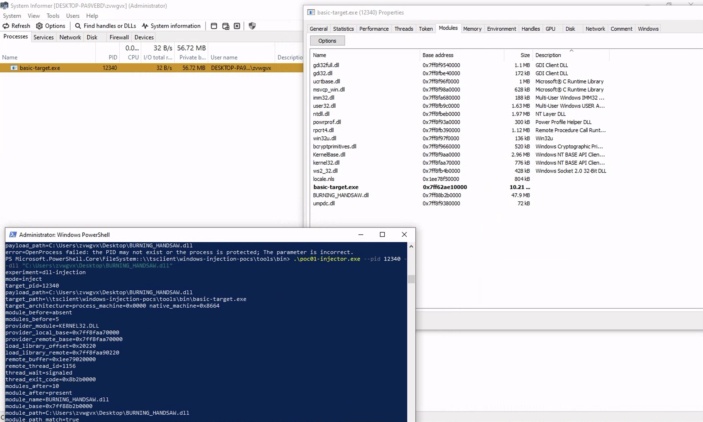

# 2026-11-11 — technique 01 runtime validation

## Identity

| Field | Value |
| --- | --- |
| Date (UTC) | 2026-11-11 |
| Build revision | Working tree on top of commit `605922f`, technique 01 files uncommitted at run time |
| Host OS and build | Windows x64 (exact build not recorded — please run `winver` and append) |
| Compiler and version | MinGW-w64 GCC 13.0.0, cross-compiled on macOS (`x86_64-w64-mingw32-g++`), CMake 4.3.0 |
| Build type | Default (no `CMAKE_BUILD_TYPE`) |
| Technique | 01 — DLL injection (`CreateRemoteThread` + `LoadLibraryW`) |

## Artifacts used

Binaries were executed from an RDP-mapped share (`\\tsclient\windows-injection-pocs\tools\bin\`).
Hashes below were computed on the build host for the exact staged files; verify with
`Get-FileHash` if needed.

| Field | Value |
| --- | --- |
| Target executable | `tools/bin/basic-target.exe`, SHA-256 `b7f531924ec752994328a8d39283ef3bac6d9c92d5176cdd925f4af7f0e85c95` |
| Payload binary | `tools/bin/poc01-payload.dll`, SHA-256 `54df5954189546e84b2921a85e7bc76fa4ba8aa5253c9df42f74c5341dde26fd` |
| Injector binary | `tools/bin/poc01-injector.exe`, SHA-256 `c4c69ff81b3e386f963fef3d4e6b12185e7560a86add2195b952bc7e57a27941` |
| Self-test binary | `tools/bin/poc01-selftest.exe`, SHA-256 `930f984fc56e116adcaa2976d10776f2c867531f72321c84ca803e201eb41c20` |
| Target source last modified | Not modified for this technique (unchanged since commit `befb6a9`) |
| Payload/source relationship | Built from `techniques/01-dll-injection/code/poc01-payload.cpp` and `poc01-injector.cpp` in this working tree |

## Procedure

```text
poc01-selftest.exe --target .\basic-target.exe --injector .\poc01-injector.exe --payload .\poc01-payload.dll
```

| Field | Value |
| --- | --- |
| Target PID reported by the harness | 1884 (from `CreateProcessW`) |
| Timeline (UTC) | Not recorded (single session, ~2 s) |

## Evidence

| Check | Expected | Observed |
| --- | --- | --- |
| Precondition `--check-only` exit code | 3 (absent) | 3 |
| Injection exit code | 0 | 0 |
| Postcondition `--check-only` exit code | 0 (present) | 0 |
| Duplicate injection exit code | 6 (refused) | 6 |
| Target still alive after experiment | yes | yes |
| `module_before` / `modules_before` | absent / N | absent / 6 |
| `module_after` / `module_path_match` | present / true | present / true (UNC path) |
| `payload_log_fresh` / `pid_match` / `base_match` | true / true / true | true / true / true |

## Raw output

```text
selftest=dll-injection
target_pid=1884
target_path=.\basic-target.exe
phase=precondition
experiment=dll-injection
mode=check-only
target_pid=1884
payload_path=\\tsclient\windows-injection-pocs\tools\bin\poc01-payload.dll
target_path=\\tsclient\windows-injection-pocs\tools\bin\basic-target.exe
target_architecture=process_machine=0x0000 native_machine=0x8664
module_before=absent
modules_before=6
result=absent
step=payload_absent_before_injection expected=3 actual=3 pass=true
phase=inject
experiment=dll-injection
mode=inject
target_pid=1884
payload_path=\\tsclient\windows-injection-pocs\tools\bin\poc01-payload.dll
target_path=\\tsclient\windows-injection-pocs\tools\bin\basic-target.exe
target_architecture=process_machine=0x0000 native_machine=0x8664
module_before=absent
modules_before=6
provider_module=KERNEL32.DLL
provider_local_base=0x7ff8faa70000
provider_remote_base=0x7ff8faa70000
load_library_offset=0x20220
load_library_remote=0x7ff8faa90220
remote_buffer=0x23bd2880000
remote_thread_id=13192
thread_wait=signaled
thread_exit_code=0xddbc0000
modules_after=7
module_after=present
module_name=poc01-payload.dll
module_base=0x7ff8ddbc0000
module_path=\\tsclient\windows-injection-pocs\tools\bin\poc01-payload.dll
module_path_match=true
payload_log=C:\Users\zvwgvx\AppData\Local\Temp\wininj-poc01\poc01-payload-1884.log
payload_log_present=true
payload_log_fresh=true
payload_log_pid_match=true
payload_log_base_match=true
result=success
step=inject expected=0 actual=0 pass=true
phase=postcondition
experiment=dll-injection
mode=check-only
target_pid=1884
payload_path=\\tsclient\windows-injection-pocs\tools\bin\poc01-payload.dll
target_path=\\tsclient\windows-injection-pocs\tools\bin\basic-target.exe
target_architecture=process_machine=0x0000 native_machine=0x8664
module_before=present
modules_before=7
module_path_match=true
result=present
step=payload_present_after_injection expected=0 actual=0 pass=true
phase=duplicate
experiment=dll-injection
mode=inject
target_pid=1884
payload_path=\\tsclient\windows-injection-pocs\tools\bin\poc01-payload.dll
target_path=\\tsclient\windows-injection-pocs\tools\bin\basic-target.exe
target_architecture=process_machine=0x0000 native_machine=0x8664
module_before=present
modules_before=7
error=payload DLL is already loaded in the target; no injection was attempted
step=duplicate_injection_refused expected=6 actual=6 pass=true
phase=target_health
step=target_still_alive expected=1 actual=1 pass=true
result=pass
```

Supplementary manual observations (same session, not part of the pass/fail chain):

```text
poc01-injector.exe --pid 1234 --dll "C:\Users\zvwgvx\Desktop\payload.dll"
-> error=OpenProcess failed: The operation completed successfully. (PID does not exist;
   injector did not report a Win32 code; diagnostics improved after this run)

poc01-injector.exe --pid 5992 --dll "C:\Users\zvwgvx\Desktop\payload.dll"
-> foreign payload loaded (module_after=present, module_path_match=true, thread signaled),
   payload_log_present=false, exit 4 verification-failed.
   Correct behavior: the injector only claims success for payloads that satisfy the
   evidence contract; a DLL without logging code must not be reported as verified.
```

Independent third-party confirmation (System Informer): the operator injected a foreign
47.9 MB DLL, `BURNING_HANDSHAW.dll` (Desktop path), into a fresh `basic-target.exe` and
inspected the target in System Informer — a tool entirely outside this repo's
toolchain. The Modules tab lists the injected DLL at exactly the base address the
injector reported:

| Observation | Injector output (`--pid 12340`) | System Informer |
| --- | --- | --- |
| Target process | `target_pid=12340` | `basic-target.exe (12340)` |
| Injected module | `module_name=BURNING_HANDSHAW.dll` | `BURNING_HANDSHAW.dll` |
| Base address | `module_base=0x7ff88b2b0000` | `0x7ff88b2b0000` |
| Module count | `modules_before=5`, `modules_after=10` (snapshot immediately after the remote thread signaled) | 18 modules at screenshot time |

The exact base-address match (`0x7ff88b2b0000` in both independent views) corroborates
the injector's snapshot and the exit 4 semantics: the injection technically occurred
while the payload-side evidence contract remained unsatisfied. The injector output in
the capture is truncated at `module_path_match=true`; the `payload_log_*` and `result=`
lines are below the visible area. `thread_exit_code=0x8b2b0000` again equals the low
32 bits of the observed base.

The module-count difference is a timing observation, not a contradiction: both views
agree the injected module is present at the identical base, while the live System
Informer view includes modules loaded after the injector's immediate snapshot — the
47.9 MB payload's runtime activity (e.g. `ws2_32.dll`, `rpcrt4.dll`) continues to pull
dependencies in. The same capture also shows the improved `OpenProcess` diagnostics in
an earlier failed attempt: `error=OpenProcess failed: the PID may not exist or the
process is protected; The parameter is incorrect.` (`ERROR_INVALID_PARAMETER` for an
invalid PID).



Screenshot file: `docs/runs/assets/2026-11-11-technique-01-system-informer.png`
(2938×1764 PNG, SHA-256 `c03925f0f248fd4deb54c570f864551aae10602d5d87a913c6141a0e67fdd6bd`).

## Follow-up runs (same day, injector `d0543f7d…`, heartbeat payload `2806f82b…`)

Additional manual runs on fresh `basic-target.exe` instances, one payload per target:

| Run | Target PID | Payload | `modules_before → after` | Result |
| --- | --- | --- | --- | --- |
| 1 | 856 | `poc01-payload.dll` | 5 → 6 | `result=success`, all log checks true |
| 2 | 3432 | `poc01-payload-heartbeat.dll` | 5 → 6 | `result=success`, all log checks true |
| foreign | 12340 | `BURNING_HANDSHAW.dll` (Desktop, 47.9 MB) | 5 → 10 | mapping confirmed via System Informer at the injector-reported base; payload-side log absent (foreign DLL), result line truncated in the capture |
| refused | not recorded (output truncated) | `poc01-payload.dll` | 18 → n/a | exit 6, `no injection was attempted` (duplicate guard) |

Notable observations:

- Both payloads were mapped at the same image base `0x7ff8f5cc0000` in different
  processes, and the truncated `thread_exit_code` (`0xf5cc0000`) again matched the low
  32 bits of the observed module base in both runs.
- The refused attempt targeted a process with 18 modules that already had
  `poc01-payload.dll` loaded; the injector refused without touching the target, as
  designed.

### Live heartbeat capture (run 2, target PID 3432)

The run 2 log was streamed live with
`Get-Content $env:TEMP\wininj-poc01\poc01-payload-3432.log -Wait` while the payload
stayed loaded:

| Field | Observed |
| --- | --- |
| Attach line | `event=dll_attach pid=3432 tid=4404 … base=0x00007ff8f5cc0000 … timestamp=2026-11-11T02:26:53.086Z` |
| Heartbeat lines | 68 × `event=heartbeat pid=3432 tid=13084 … base=0x00007ff8f5cc0000 uptime_ms=516…35797` |
| Interval | ~515–530 ms across the whole capture, steady (`Sleep(500)` + scheduling) |
| Cross-checks | `pid` matches the injector's `target_pid=3432`; `base` matches `module_base=0x7ff8f5cc0000`; attach `tid=4404` equals the injector's `remote_thread_id=4404` |

The attach thread id being exactly the remote thread the injector created links the
payload-side log to the injector-side thread creation: `DllMain` ran on that thread, and
the payload's own heartbeat thread (`tid=13084`) kept appending evidence for at least
~35.8 s of uptime while the capture was watched.

Excerpt (first, second, and last lines of the capture):

```text
event=dll_attach pid=3432 tid=4404 payload_id=poc01-heartbeat base=0x00007ff8f5cc0000 module=\\tsclient\windows-injection-pocs\tools\bin\poc01-payload-heartbeat.dll timestamp=2026-11-11T02:26:53.086Z
event=heartbeat pid=3432 tid=13084 payload_id=poc01-heartbeat base=0x00007ff8f5cc0000 uptime_ms=516 timestamp=
event=heartbeat pid=3432 tid=13084 payload_id=poc01-heartbeat base=0x00007ff8f5cc0000 uptime_ms=35797 timestamp=
```

Known cosmetic defect visible in this capture: heartbeat lines end with an empty
`timestamp=` field (the format string omitted the value). Fixed after this capture; see
"Deviations and limitations".

## Deviations and limitations

- Executed over an RDP-mapped share (`\\tsclient\`); module paths and `LoadLibraryW`
  resolved against the UNC path and the evidence chain still matched. No local-disk copy
  was used.
- Windows build number not recorded.
- The injector binary was changed after this run (OpenProcess failure diagnostics only);
  the recorded hash `c4c69ff8…` is the binary that produced this evidence. Current build
  is `d0543f7d…`.
- The heartbeat payload binary was patched after the live capture above to fill the
  previously empty `timestamp=` field in heartbeat lines (UTC, same format as the attach
  line). The recorded capture was produced by `2806f82b…`; the fixed build is
  `0b8a1b20…`. Log contract (`pid=` + `base=` tokens) is unchanged, so injector
  verification is unaffected.
- The technique proves injection and code execution under the recorded conditions. It
  does not claim stealth, persistence, or universal reliability; `CreateRemoteThread`
  is heavily monitored by EDR products.
