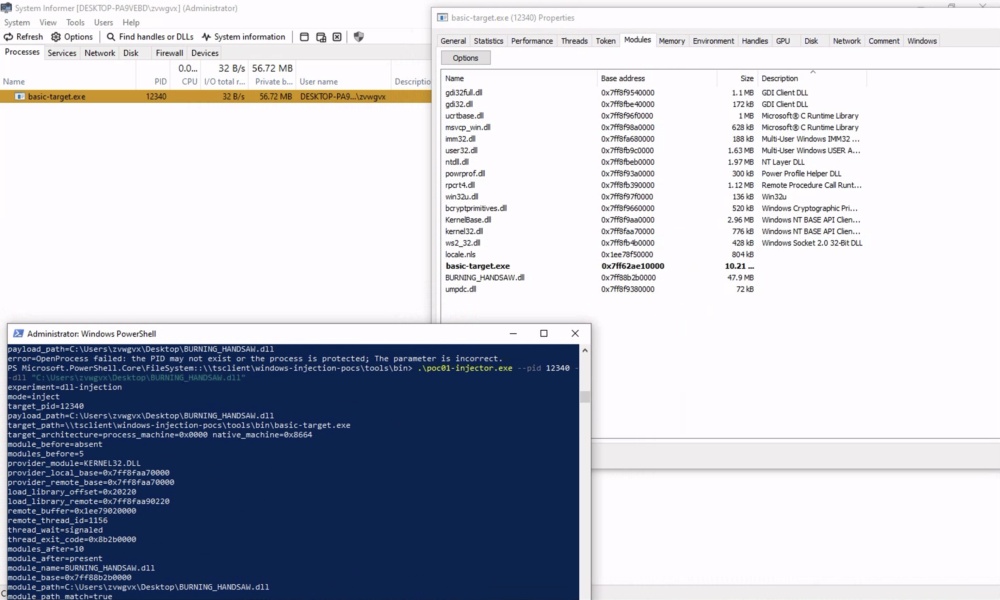

# 01 — DLL Injection

**Status:** Implemented — runtime evidence recorded in [docs/runs/2026-11-11-technique-01.md](../../docs/runs/2026-11-11-technique-01.md).

This experiment uses the classic remote `LoadLibraryW` sequence. It does not use a
named event, pipe, RPC endpoint, window message, hook, target export, command-line
switch, or environment variable to make the target load the payload.

## Evidence

Runtime evidence was recorded on Windows 10 Pro 22H2 (build 19045.6456, x64) on
2026-11-11. The full absence → inject → presence → duplicate-refusal chain passed on
the unmodified target, and the payload log was verified from inside the target. The
complete record, raw output, and artifact hashes are in
[docs/runs/2026-11-11-technique-01.md](../../docs/runs/2026-11-11-technique-01.md).

| Run | Target | Payload | Result |
| --- | --- | --- | --- |
| self-test | PID 1884 | `poc01-payload.dll` | `result=pass` (exits 3 → 0 → 0 → 6, target alive) |
| manual | PID 856 | `poc01-payload.dll` | `result=success`, all log checks true |
| manual | PID 3432 | `poc01-payload-heartbeat.dll` | `result=success`; live heartbeat for ~35.8 s uptime |
| foreign | PID 12340 | `BURNING_HANDSHAW.dll` (47.9 MB, Desktop) | module present at `0x7ff88b2b0000`; exit 4 by design (capture truncated at `module_path_match=true`) |

Third-party confirmation with System Informer — the injected module appears in the
target's module list at exactly the base address the injector reported:



`target_pid=12340` and `module_base=0x7ff88b2b0000` match the System Informer view byte
for byte, and `thread_exit_code=0x8b2b0000` equals the low 32 bits of that base. The
live heartbeat capture is in the same run record.

## Components

| File | Role |
| --- | --- |
| `code/poc01-injector.cpp` | Opens the target, allocates/writes the DLL path, starts a remote thread at `LoadLibraryW`, and verifies the result |
| `code/poc01-payload.cpp` | Ordinary DLL. `DllMain` writes a PID/base-stamped evidence line to `%TEMP%\wininj-poc01\poc01-payload-<pid>.log` |
| `code/poc01-payload-heartbeat.cpp` | Payload variant that keeps appending a heartbeat line while loaded; both variants satisfy the same log contract |
| `code/poc01-selftest.cpp` | Negative control, injection, postcondition, duplicate-refusal, and target-health checks |

The target programs under [`targets/`](../../targets/) are unchanged. They have no
injector-aware code, callback, event, or loader interface.

## Mechanism

The injector performs the following operations against an already-running x64
process:

1. `OpenProcess` with `PROCESS_CREATE_THREAD | PROCESS_QUERY_INFORMATION |
   PROCESS_VM_OPERATION | PROCESS_VM_WRITE`.
2. A read-only `Toolhelp32` module snapshot confirms that the exact payload path is
   not already loaded. A same-named module from another path also causes refusal.
3. `VirtualAllocEx` + `WriteProcessMemory` place the full DLL path in the target.
4. The injector resolves the local `LoadLibraryW` export, finds the module that
   contains it (`kernel32.dll` or `kernelbase.dll`), and computes the same offset in
   the target's copy of that module.
5. `CreateRemoteThread` calls the remote `LoadLibraryW` with the remote path.
6. After the thread completes, a second module snapshot must show the payload at
   the exact full path.
7. The payload's `DllMain` log must be fresh and contain both the target PID and the
   observed module base.

Before injection, the injector removes a previous per-PID evidence file so stale
content cannot satisfy the log check. File freshness and the PID/base tokens are
still verified after the remote thread completes.

The injector's exit status is success only when all checks pass. A loaded module by
itself is not treated as sufficient proof.

## Why this is not cooperative injection

- The target source is not modified and is never rebuilt for this technique.
- The target does not create an event, pipe, socket, RPC server, window message
  handler, hook, or exported "load DLL" function.
- The injector receives only a PID and a DLL path. It does not ask the target for
  permission or wait for a target-side signal.
- The self-test may launch the target and read its PID from `CreateProcessW`. That is
  ground-truth process identity, not a target-side loading protocol.
- Before injection, `--check-only` must report the payload as absent. After
  injection, a second injector run must refuse with exit code 6. Those two negative
  controls make a prearranged load visible.

## Usage

### Run bundle

The staged bundle in [`tools/bin/`](../../tools/bin/) contains five statically linked
binaries (`basic-target.exe`, `poc01-injector.exe`, `poc01-payload.dll`,
`poc01-payload-heartbeat.dll`, `poc01-selftest.exe`). Copy it to a Windows x64 machine
or run it directly over an RDP-mapped share such as
`\\tsclient\windows-injection-pocs\tools\bin\`.

To build and stage it yourself on Windows:

```powershell
cmake -S . -B build -A x64
cmake --build build --config Release      # the stage-poc01 target fills tools/bin/
```

Cross-compiling from macOS or Linux with MinGW-w64 also works (compile-only
validation):

```bash
cmake -S . -B build-mingw -DCMAKE_SYSTEM_NAME=Windows \
  -DCMAKE_CXX_COMPILER=x86_64-w64-mingw32-g++
cmake --build build-mingw -j 8
```

### Self-test (one command)

```powershell
cd \\tsclient\windows-injection-pocs\tools\bin
.\poc01-selftest.exe --target .\basic-target.exe --injector .\poc01-injector.exe --payload .\poc01-payload.dll
```

Expected phases: `precondition` (exit 3), `inject` (exit 0), `postcondition`
(exit 0), `duplicate` (exit 6), `target_health` (alive), then `result=pass`.

### Manual injection

Start a fresh target in one window; it prints its PID:

```powershell
.\basic-target.exe --duration-sec 120
# BasicTarget pid=<PID> ...
```

In another window, in the same directory:

```powershell
# negative control: must report absent (exit 3)
.\poc01-injector.exe --pid <PID> --dll .\poc01-payload.dll --check-only

# inject
.\poc01-injector.exe --pid <PID> --dll .\poc01-payload.dll

# payload-side evidence, written from inside the target
Get-Content "$env:TEMP\wininj-poc01\poc01-payload-<PID>.log"
```

Expected injector output ends with:

```text
module_before=absent
provider_module=KERNEL32.DLL
remote_thread_id=....
module_after=present
module_path_match=true
payload_log=...\wininj-poc01\poc01-payload-<PID>.log
payload_log_fresh=true
payload_log_pid_match=true
payload_log_base_match=true
result=success
```

The payload remains loaded until the target exits. The injector does not call
`FreeLibrary` in the target.

### Heartbeat payload variant

Use a **fresh** target for the second variant:

```powershell
.\basic-target.exe --duration-sec 120          # new PID
.\poc01-injector.exe --pid <PID> --dll .\poc01-payload-heartbeat.dll
Get-Content "$env:TEMP\wininj-poc01\poc01-payload-<PID>.log" -Wait
```

The log gets one `event=dll_attach` line, then an `event=heartbeat` line about every
500 ms with an increasing `uptime_ms` and a UTC `timestamp` — live proof that the
payload keeps executing inside the target. The heartbeat thread stops by itself as soon
as the DLL is unloaded.

### Expected refusals and controls

| Command | Exit | Meaning |
| --- | --- | --- |
| `--check-only` before injection | 3 | payload absent |
| `--check-only` after injection | 0 | payload present at the exact path |
| second injection of the same DLL into the same target | 6 | duplicate guard; no injection attempted |
| injection of a foreign DLL that writes no evidence log | 4 | injection occurred, evidence chain incomplete |

### Notes

- Use one fresh target per payload variant: the injector deletes the per-PID log before
  injecting, and a same-named module loaded from a different path is refused.
- Relative `--dll` paths resolve against the injector's working directory, not the
  target's; quote paths that contain spaces.
- Running from an RDP-mapped share (`\\tsclient\...`) is supported: the module path is
  verified against the UNC path, while the evidence log still lands in the target
  session's local `%TEMP%`.

## Exit codes

| Code | Meaning |
| --- | --- |
| `0` | Injection and full evidence chain succeeded, or `--check-only` found the DLL |
| `1` | Invalid command line |
| `2` | Win32/process/snapshot/thread error |
| `3` | `--check-only` found the DLL absent |
| `4` | Module appeared, but the evidence chain was incomplete (freshness/PID/base/path) |
| `5` | Remote thread completed but the module was not found |
| `6` | Payload was already loaded, or a same-named module exists from another path; no injection attempted |

## Test

```powershell
cmake --build build --config Release
ctest --test-dir build -C Release -R dll-injection-smoke --output-on-failure
```

`dll-injection-smoke` runs the actual injector against `basic-target.exe`, checks the
absence/presence transition, rejects a duplicate injection, and confirms the target
is still alive. It requires same-user x64 Windows. Windows Defender or another EDR
may block `CreateRemoteThread`; use a lab VM and record the block instead of
weakening the evidence chain.

## Limits

- Same-user, same-session, same-integrity x64 target only. No privilege escalation.
- `CreateRemoteThread` is a well-known, heavily monitored API. This PoC does not
  implement evasion, persistence, process discovery, or payload staging.
- The evidence log path is under the user's `%TEMP%`. If the target runs as a
  different user, the injector may not see the log and will report verification
  failure rather than success.
- The payload writes a small file from `DllMain` while the loader lock is held. That
  is acceptable for this controlled experiment but is not a template for production
  DLLs.
- A successful run proves this mechanism under the recorded Windows build. It does
  not prove that the technique is stealthy or universally reliable.

Use only against processes and binaries you own or are explicitly authorized to
test.
